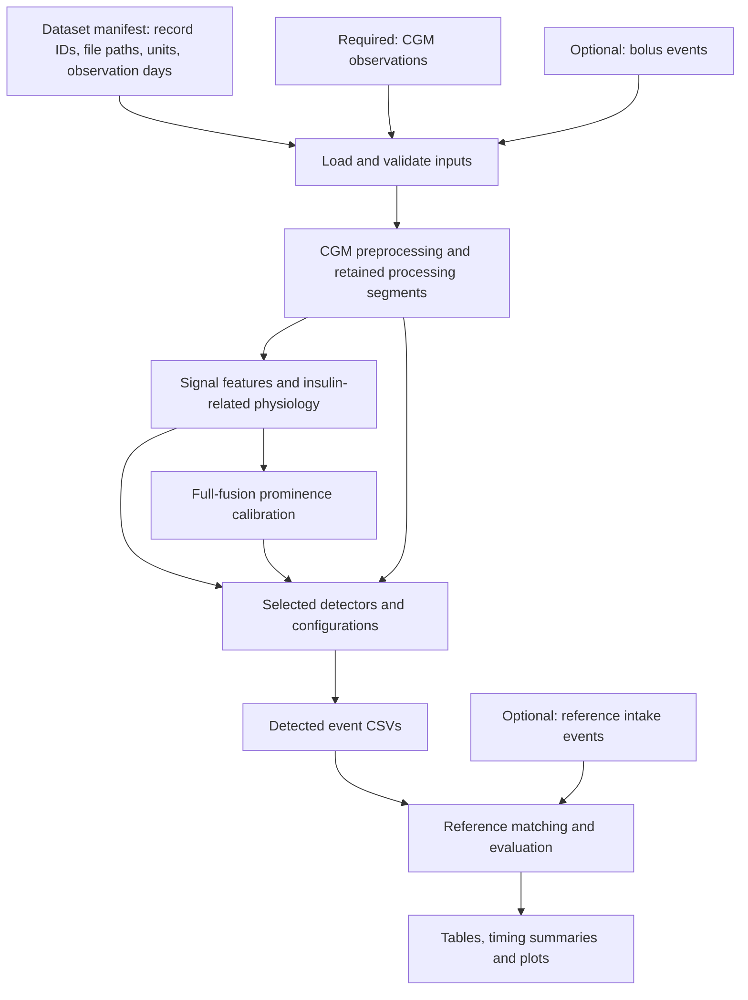

# Retrospective Food Intake Detection

Code accompanying **Context-aware and Fusion-based Retrospective Food Intake Detection for Diabetes Datasets**, prepared for submission to IEEE Journal of Biomedical and Health Informatics (JBHI).

This repository detects food-intake events retrospectively from continuous glucose monitoring (CGM), with optional bolus insulin information. It provides a common input interface, the fusion method, a baseline, ablation and sensitivity configurations, event evaluation, and table/figure generation.

**Start here:** install the dependencies, run the synthetic example, then prepare your own CSV files and dataset manifest. No clinical dataset is required for the synthetic example.

**Current validation:** the workflow has passed connectivity testing on synthetic data and one NHS session across all eight configurations. The complete NHS cohort has not yet been rerun and compared with manuscript results using this workflow. Successful execution is not a claim of numerical reproduction. See [validation evidence](docs/connectivity_validation.md).

## Contents

- [Workflow and architecture](#workflow-and-architecture)
- [Repository structure](#repository-structure)
- [1. Install the environment](#1-install-the-environment)
- [2. Run the synthetic example](#2-run-the-synthetic-example)
- [3. Prepare your input data](#3-prepare-your-input-data)
- [4. Validate inputs and inspect the plan](#4-validate-inputs-and-inspect-the-plan)
- [5. Run detection and experiments](#5-run-detection-and-experiments)
- [Calibration](#calibration)
- [Read the outputs](#read-the-outputs)
- [Reproduce the NHS experiments](#reproduce-the-nhs-experiments)
- [Checks and troubleshooting](#checks-and-troubleshooting)
- [Scope, citation and license](#scope-citation-and-license)

## Workflow and architecture

The starting point is **standard CSV files plus a JSON dataset manifest**. The manifest describes the records and points to their files. “Prepared inputs” means the files follow this interface; CGM observations are still raw, and this code performs signal preprocessing.

Converting device-specific exports into these columns, assembling reference labels, and any required date shifting take place upstream.



Reference events are used only for evaluation and annotated figures. They do not enter preprocessing, feature extraction, physiology estimation, scores or threshold calibration.

The runner computes full-fusion features once per record and reuses them across the selected fusion-derived configurations. Baseline-only runs skip fusion scoring and prominence calibration.

## Repository structure

```text
retrospective-food-intake-detection/
├── README.md
├── requirements.txt
├── reproduce.py                  # Recommended user entry point
├── run_experiments.py            # Workflow orchestration and evaluation
├── fusion_main.py                # Feature/scoring pipeline
├── fusion_based.py               # Shared signal and physiology calculations
├── pipelines/
│   ├── dataset_io.py             # Standard manifest/CSV loading and preparation
│   ├── glucose_preprocessing.py  # CGM interpolation and missing-data handling
│   ├── physio_kf.py              # Physiological estimation
│   ├── fusion_scoring.py         # Window features and fusion scores
│   ├── fusion_refinement_new.py  # Prominence-based event detection
│   ├── prominence_threshold.py  # Shared threshold calibration and reuse
│   ├── gap_masking.py           # Retained segments and invalid-window masks
│   ├── event_matching.py        # One-to-one reference/detection matching
│   └── ...                     # Supporting calculation modules
├── configs/
│   ├── dataset.example.json     # Example standard dataset manifest
│   ├── primary.json             # Primary method settings
│   ├── sensitivity.json         # Trend and weighting settings
│   └── nhs_cohort.json           # Frozen NHS cohort definition
├── examples/
│   └── synthetic_demo.py        # Generates a synthetic input bundle
├── datasets/
│   └── README.md               # External input instructions; clinical data excluded
├── results/                    # Generated run directories; outputs excluded from Git
├── plots/                      # Reserved plot directory
├── tests/                      # Input and algorithm regression tests
├── docs/                       # Detailed input, execution and validation documents
├── summary_table.py            # Participant table generation
├── result_plot.py              # Onset summaries and plots
├── results-display.py          # Three-panel example figure
├── ...                         # Retained evaluation and auxiliary scripts
├── CITATION.cff
└── LICENSE
```

Use `reproduce.py` for the documented workflow. You do not need to run individual modules or manually copy event files between folders. Local NHS source-format preparation tools, private audit files and internal comparison experiments are outside the reader release.

## 1. Install the environment

Clone the repository using a GitHub account with access while it is private:

```bash
git clone https://github.com/Ivy-Cheng/retrospective-food-intake-detection.git
cd retrospective-food-intake-detection
```

Create and activate a Python environment. For example, on macOS/Linux with Python 3.12 installed:

```bash
python3.12 -m venv .venv
source .venv/bin/activate
python -m pip install -r requirements.txt
```

On Windows, activate the environment with `.venv\Scripts\Activate.ps1` in PowerShell.

The following environment was verified through a fresh installation, regression tests, the synthetic example, and the complete NHS experiment workflow:

| Component | Tested version |
| --- | --- |
| Python | 3.12.7 |
| NumPy | 1.26.4 |
| pandas | 2.2.3 |
| SciPy | 1.14.1 |
| FilterPy | 1.4.5 |
| matplotlib | 3.9.2 |
| Plotly | 5.24.1 |

Direct dependencies are pinned in requirements.txt. Installation and execution were verified with Python 3.12.7 using the versions listed above. These are the verified reproduction environment versions, not necessarily the original research environment.

Run all subsequent commands from the repository root.

## 2. Run the synthetic example

Generate one synthetic session containing CGM, bolus events, reference events and a manifest:

```bash
python examples/synthetic_demo.py --out-dir examples/generated/demo
```

Validate the input bundle, then run all eight configurations:

```bash
python reproduce.py \
  --manifest examples/generated/demo/manifest.json \
  --validate-inputs

python reproduce.py \
  --manifest examples/generated/demo/manifest.json \
  --methods all \
  --smoke \
  --out-dir results/demo
```

The example includes a retained gap to exercise missing-data masking. The run produces event CSVs, evaluation summaries, table data and figures. Inspect `results/demo/run_manifest.json` for completion status and run provenance.

This is a connectivity demonstration. Synthetic metrics are not paper results.

The generator refuses to overwrite existing CSVs. For another demonstration, choose a new input directory and a new output directory.

## 3. Prepare your input data

### Required and optional files

Provide up to three CSV files per session:

| Input | Required? | Exact columns | Unit / purpose |
| --- | --- | --- | --- |
| CGM | Yes | `ts,value` | Raw glucose observations in mmol/L |
| Bolus | No | `ts,dose` | Insulin doses in U |
| Reference events | No | `ts` | Prepared food-intake onsets for evaluation |

With CGM alone, the pipeline can detect events using its signal-feature fallback. Bolus information enables the insulin-related physiology component when its availability conditions are met. Missing bolus data must not be interpreted as confirmation that no insulin was administered.

Reference labels are needed only to evaluate detection performance. If you do not have labels, omit them; detection still runs.

### CSV examples

CGM, for example `glucose.csv`:

```csv
ts,value
2000-01-01T08:00:00,6.2
2000-01-01T08:05:00,6.4
2000-01-01T08:10:00,6.8
```

Bolus, for example `bolus.csv`:

```csv
ts,dose
2000-01-01T07:55:00,4.0
2000-01-01T12:30:00,5.5
```

References, for example `references.csv`:

```csv
ts
2000-01-01T08:00:00
2000-01-01T12:35:00
```

These short snippets illustrate the format; they are not sufficient recordings for running the detector. Use the synthetic example for an executable input.

### File layout and manifest

A convenient layout is:

```text
datasets/my_dataset/
├── manifest.json
└── records/
    ├── p01_session1/
    │   ├── glucose.csv
    │   ├── bolus.csv
    │   └── references.csv
    └── p01_session2/
        └── ...
```

Create `datasets/my_dataset/manifest.json`:

```json
{
  "schema_version": 1,
  "dataset_id": "my_dataset",
  "time_basis": "local_naive",
  "units": {
    "glucose": "mmol/L",
    "bolus": "U"
  },
  "records": [
    {
      "record_id": "p01_session1",
      "participant_id": "p01",
      "session_id": "session1",
      "monitoring_days": 1.0,
      "glucose_file": "records/p01_session1/glucose.csv",
      "bolus_file": "records/p01_session1/bolus.csv",
      "reference_file": "records/p01_session1/references.csv"
    }
  ]
}
```

One manifest can describe multiple participants and sessions. Add an object to `records` for each session.

| Field | Meaning |
| --- | --- |
| `schema_version` | Input schema version; use `1` |
| `dataset_id` | A descriptive dataset identifier |
| `time_basis` | Use `local_naive`: aligned local timestamps without timezone offsets |
| `units` | Declare glucose `mmol/L` and bolus `U`, even if bolus files are omitted |
| `record_id` | Unique session record ID; letters, digits, underscores and hyphens |
| `participant_id` | Groups sessions belonging to the same participant for evaluation |
| `session_id` | Identifies the session within that participant |
| `monitoring_days` | Positive observation duration used as the FP/day denominator; required with references |
| `glucose_file` | Required CGM CSV path |
| `bolus_file` | Optional bolus CSV path; omit this field when unavailable |
| `reference_file` | Optional reference CSV path; omit this field when unavailable |

Paths in the manifest are resolved relative to the manifest's directory. The folder names and CSV filenames can differ from this example if the declared paths are correct.

If `participant_id` is omitted, each record is treated as a separate participant. Supply participant IDs when multiple sessions belong to the same person.

For a CGM-only record, keep `glucose_file` and remove `bolus_file` and `reference_file`. No empty placeholder files are required.

### Timing, units and missing data

- Use complete ISO 8601 dates and times, such as `2000-01-01T08:05:00`, without `Z` or timezone offsets.
- Use the same local clock across CGM, bolus and reference files. Resolve timezone/DST differences before supplying inputs; the loader does not infer conversions.
- Bolus timestamps must align to whole minutes. CGM timestamps are floored to minutes during preprocessing.
- Convert glucose to mmol/L before use. Declaring units in the manifest does not convert mg/dL values.
- Supply finite observed CGM values; represent missing periods by absent observations rather than blank/NaN measurement rows. Do not pre-impute gaps for this workflow.
- Supply finite, non-negative bolus doses.
- Raw duplicate CGM observations are allowed and handled by the included preprocessing.
- Recordings need sufficient retained data for the 90-minute feature windows. The runner requires at least 91 prepared CGM points; the baseline's 125-sample filter also requires sufficiently long retained segments.
- Set `monitoring_days` from the intended observation duration. It is not inferred from the number of calendar dates touched by a session.

The code performs day-wise preprocessing, including short-gap interpolation and the existing >216-minute day-exclusion rule. Remaining prepared-CGM gaps longer than 30 minutes separate processing segments; fusion excludes overlapping 90-minute windows. See the [full input and preprocessing specification](docs/data_format.md).

Your own data do not need virtual dates. The external NHS bundle uses date shifting as part of its upstream preparation.

## 4. Validate inputs and inspect the plan

Before running a new dataset:

```bash
python reproduce.py \
  --manifest datasets/my_dataset/manifest.json \
  --validate-inputs

python reproduce.py \
  --manifest datasets/my_dataset/manifest.json \
  --plan
```

Input validation reads all declared session CSVs, checks required columns, timestamps and numeric values, and verifies optional file checksums. It does not run preprocessing or detection and does not guarantee that every session contains enough usable data.

The plan displays selected record IDs, methods and calibration mode without running the experiment.

## 5. Run detection and experiments

### Run the fusion method on your data

```bash
python reproduce.py \
  --manifest datasets/my_dataset/manifest.json \
  --methods fusion \
  --out-dir results/my_fusion_run
```

With references, evaluation is generated automatically. Without references, the run saves detections and an explicit evaluation-status note.

### Run a small connectivity check

Select one or two record IDs:

```bash
python reproduce.py \
  --manifest datasets/my_dataset/manifest.json \
  --records p01_session1 \
  --methods all \
  --smoke \
  --out-dir results/my_smoke
```

`--smoke` labels the execution as connectivity-only and restricts it to at most two records. It does not automatically select records from a larger manifest.

### Run every configuration on every record

```bash
python reproduce.py \
  --manifest datasets/my_dataset/manifest.json \
  --methods all \
  --out-dir results/my_all_methods
```

Omitting `--records` includes every record in the manifest. Omitting `--smoke` allows a full dataset run; it still does not compare results with manuscript targets.

### Available methods

| CLI name | Configuration |
| --- | --- |
| `baseline` | Glucose-based heuristic baseline |
| `fusion` | Main fusion configuration |
| `signal_only` | Signal-feature ablation |
| `physiology_only` | Physiology-feature ablation |
| `dexcom` | Fusion with the 15-minute Dexcom G7 trend definition |
| `equal_weights` | Fusion with exactly one-third weight per component |
| `signal_leaning` | Signal-leaning sensitivity configuration |
| `physiology_leaning` | Physiology-leaning sensitivity configuration |

Select any subset, for example `--methods baseline fusion signal_only physiology_only`. The default is all eight configurations. Published settings are declared in [primary settings](configs/primary.json) and [sensitivity settings](configs/sensitivity.json).

CGM-only inputs exercise fallback behavior; they do not supply independent physiology information for the physiology-only ablation.

### Useful options

| Option | Behavior |
| --- | --- |
| `--records ID [ID ...]` | Restrict execution to named records |
| `--methods NAME [NAME ...]` | Select configurations, or use `all` |
| `--threshold-file PATH` | Apply a previously fitted threshold artifact |
| `--no-figures` | Skip figure generation |
| `--out-dir PATH` | Choose a run directory outside the input dataset directory |
| `--overwrite` | Explicitly permit writing into an existing nonempty output directory |
| `--help` | Display the command-line options |

Use a new output directory for each run. A nonempty directory is rejected unless `--overwrite` is supplied. For a clean record of a different method selection, prefer a new directory.

The three-panel example figure requires both `baseline` and `fusion` to be selected. A fusion-only run therefore does not create that comparison figure.

## Calibration

Every fusion-derived configuration uses one shared, unrounded full-fusion 75th-percentile (Q75) prominence threshold. Reference labels are not used.

| Use case | Threshold source |
| --- | --- |
| Your own dataset, no calibration declared | Automatic full-fusion candidate collection on the selected records |
| NHS paper reproduction | Supplied historical full-fusion candidate-export pool |
| Explicit `--threshold-file` | Previously fitted threshold metadata |
| Baseline only | No prominence calibration required |

### New datasets

Omit the `calibration` section from the dataset manifest. The runner collects full-fusion candidates before acceptance, including segment-start boundary candidates, pools their prominences, and computes Q75. The same threshold is applied to all selected fusion-derived methods.

For automatic calibration, `--records` also changes the calibration population. A one-session smoke run may therefore use a different threshold from a full-dataset run.

To apply the threshold fitted in an earlier run:

```bash
python reproduce.py \
  --manifest datasets/my_dataset/manifest.json \
  --methods all \
  --threshold-file results/my_all_methods/calibration/dataset_threshold.json \
  --out-dir results/my_reused_threshold
```

The previous artifact must already exist. Reuse the calibration appropriate to your experiment and retain its provenance.

### NHS paper mode

NHS reproduction preserves the historical candidate-export definition rather than replacing it with the automatic new-data pool. The prepared NHS manifest declares:

```json
"calibration": {
  "mode": "historical_candidate_exports",
  "manifest_file": "calibration/manifest.json"
}
```

This is a fragment of the dataset manifest. The separate calibration manifest lists the historical candidate CSVs. All 31 sessions and all 594 finite historical prominence rows are used, including when detection is restricted to one NHS session.

An empty candidate pool cannot define Q75 and causes an error. Candidate rows and threshold metadata are saved with the run.

## Read the outputs

A typical all-method run with references creates:

```text
results/my_all_methods/
├── RUN_SCOPE.txt
├── run_manifest.json
├── scores/
│   └── <record_id>/                 # Prepared signals, features and full-fusion trajectory
├── calibration/
│   ├── dataset_threshold.json
│   └── <record_id>_full_fusion_candidates.csv  # Automatic calibration only
├── events/
│   ├── baseline/<record_id>.csv
│   ├── fusion/<record_id>.csv
│   └── <other_method>/<record_id>.csv
├── evaluation/
│   ├── evaluation_by_session.csv
│   ├── evaluation_by_participant_all_methods.csv
│   ├── evaluation_summary_all_methods.csv
│   ├── table_iii.csv
│   ├── table_iv.csv
│   ├── table_vi.csv
│   └── primary/
│       ├── ...                     # Primary-method evaluation and onset errors
│       └── onset/                  # Timing summaries and plots
└── figures/
    └── example_<record_id>.png
```

Files depend on the methods, reference availability and figure options.

| Output | How to use it |
| --- | --- |
| `events/<method>/<record_id>.csv` | Detected events; baseline onset column is `tmeal`, fusion-derived onset column is `onset_time` |
| `calibration/dataset_threshold.json` | Threshold value, candidate population and calibration provenance |
| `evaluation_by_session.csv` | Per-session TP, FP, FN, observation days and onset-error summaries |
| `evaluation_by_participant_all_methods.csv` | Session counts pooled within each participant |
| `evaluation_summary_all_methods.csv` | Participant-level macro means and sample standard deviations |
| `table_iii.csv`, `table_iv.csv`, `table_vi.csv` | Generated data corresponding to the paper's primary, sensitivity and participant summaries |
| `run_manifest.json` | Completion status, selected records/methods, input hashes, configuration hashes and package versions |
| `RUN_SCOPE.txt` | Whether the execution was a connectivity check or an experiment run |

Evaluation uses one-to-one matching within an inclusive ±45-minute window, assigning eligible pairs in ascending absolute time difference. Sessions are pooled within participants before group summaries. `monitoring_days` supplies the FP/day denominator. Sample standard deviations are undefined for a single participant, so blank SD cells are expected in a one-participant run.

If no reference files are supplied, evaluation writes `NO_REFERENCES.txt` instead of performance tables. When only some records have references, detection covers all selected records and evaluation covers the labeled records.

A completed run records `status: "passed"`. Its `paper_result_validation` remains `false`: the runner does not automatically compare the outputs with the manuscript. Table filenames indicate their intended paper mapping, not verified agreement with published values.

## Reproduce the NHS experiments

The initial paper-reproduction scope is the NHS primary, ablation and sensitivity experiments: **16 participants and 31 sessions**, excluding participant 17/aspart.

The clinical bundle is **not included in this repository**. Data-sharing permission remains unresolved. The following commands require the already prepared external NHS bundle; cloning the code alone is insufficient for these experiments.

Place the bundle at:

```text
datasets/nhs_v1/
├── manifest.json
├── records/                     # CGM, bolus and prepared references
└── calibration/
    ├── manifest.json
    └── ...                     # Historical candidate prominences
```

The bundle contains date-shifted raw CGM/bolus observations, reference events assembled upstream from reports and confirmed scheduled meals, and the historical calibration inputs. The code does not add scheduled meals during detection or evaluation. Each approximately 24-hour NHS session contributes one observation day.

Validate and run a single-session connectivity check:

```bash
python reproduce.py \
  --manifest datasets/nhs_v1/manifest.json \
  --validate-inputs

python reproduce.py \
  --manifest datasets/nhs_v1/manifest.json \
  --records nhs_01_fiasp \
  --methods all \
  --smoke \
  --out-dir results/nhs_smoke
```

To execute the complete NHS cohort later:

```bash
python reproduce.py \
  --manifest datasets/nhs_v1/manifest.json \
  --methods all \
  --out-dir results/nhs_full
```

This full-cohort command is available but has not been executed and accepted against manuscript targets in the current validation stage. Historical aggregate targets are not distributed as final acceptance values.

The separate clinician-adjudication dataset and its evaluation are outside this workflow. See [paper-to-code mapping](docs/paper_result_mapping.md) and [clinician evaluation scope](docs/clinician_evaluation_scope.md).

## Checks and troubleshooting

Run the source/cohort integrity check and regression tests:

```bash
python reproduce.py --check-layout
python -m unittest discover -s tests -p 'test_*.py'
```

The source check verifies declared file hashes and the frozen NHS cohort definition. It requires no clinical data. Regression tests cover inputs, matching, calibration, gap handling and selected scoring behavior; they do not replace a full paper-result comparison.

| Symptom | What to check |
| --- | --- |
| Missing CSV or manifest | Paths are relative to the manifest directory, not your shell's current directory |
| Required units error | Keep the declared units exactly as shown and convert actual values before use |
| Timestamp/timezone error | Use aligned ISO 8601 local times without timezone offsets; bolus times must be minute-aligned |
| Insufficient prepared CGM points | Check recording duration and data retained after gap/day exclusion |
| Empty prominence pool | Inspect retained CGM and full-fusion score outputs; Q75 cannot be fitted without candidates |
| Smoke run rejects a large dataset | Select one or two records explicitly with `--records` |
| Existing output directory error | Choose a new `--out-dir`, or explicitly use `--overwrite` |
| No performance tables | Supply reference files and positive `monitoring_days` for the records to evaluate |
| No three-panel comparison figure | Select both baseline and fusion and omit `--no-figures` |
| NHS smoke threshold uses all sessions | Expected: NHS mode always retains the complete historical calibration pool |

Inputs under `datasets/`, generated results and synthetic CSVs are Git-ignored. Keep private clinical files outside commits. The full input contract is in [docs/data_format.md](docs/data_format.md); additional execution details are in [docs/reproduction.md](docs/reproduction.md).

## Scope, citation and license

## Scope, citation and license

This repository provides preprocessing, feature extraction, food-intake detection, and evaluation through a standard CSV and manifest interface. Clean-environment installation and the NHS primary, ablation, and sensitivity experiments have been verified
using the prepared external NHS inputs. Reproducing these experiments requires access to those inputs; cloning this repository alone is insufficient. The clinician-adjudicated evaluation is outside the current reader-facing reproduction scope.

If you use this software in research, please cite the associated manuscript as described in [CITATION.cff](CITATION.cff), and report the software release or commit used. Publication details will be updated when available.

The original software in this repository is licensed under the [MIT License](LICENSE). NHS and clinician-adjudicated datasets are external inputs and are not distributed or licensed by this repository. Third-party components remain subject to their respective licences.
